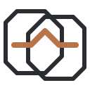
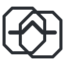
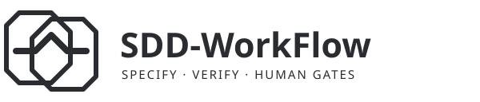

# Brand

Linked geometric frames represent durable specifications and evidence; one unbroken
path represents a workflow with human gates. No generic AI sparkles, robot or brain.
Graphite `#292D32`, copper `#B8734B`, monochrome graphite variants. Transparent,
standalone SVGs contain no scripts, external references, fonts or resources.
Wordmarks use the viewer's sans-serif fallback; at least 400px wide is recommended.

| Variant | Preview |
| --- | --- |
| Icon |  |
| Wordmark |  |
| Monochrome icon |  |
| Monochrome wordmark |  |

All assets share the [MIT license](../LICENSE).
